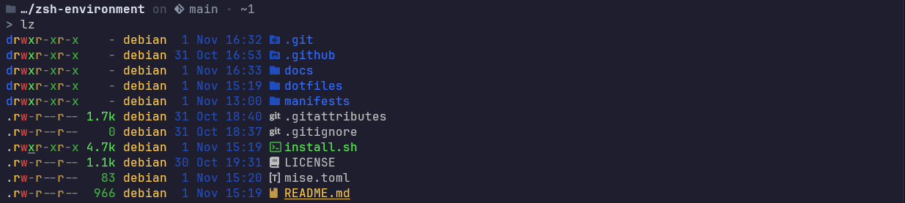
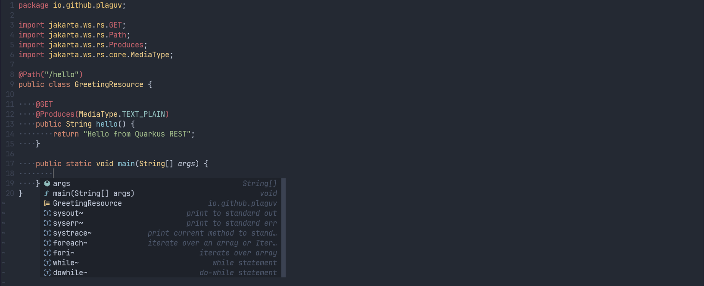

# Zsh Environment

A portable shell environment for my workstations. It uses [Zsh](https://www.zsh.org/) as the shell, [Starship](https://starship.rs/) for the prompt, and [mise](https://mise.jdx.dev/) to deploy dotfiles and manage language runtimes and command-line tools.

## Install

Simply clone the repository and run the installer:

```sh
./install.sh
```

The installer sets up base packages, applies the dotfiles from `dotfiles/`, and installs runtimes and command-line tools declared in the mise configuration. See the [installation guide](docs/INSTALLATION.md) for prerequisites and manual setup instructions.

## Terminal preview



## Neovim preview


